# System Design: Entity-Relationship Diagram (ERD) & Arsitektur Basis Data
## Sistem Administrasi Kawasan Pergudangan

---

## 1. Filosofi Desain Basis Data (Database-First Integrity)

Karena sistem dibangun dengan pendekatan **Backend-First** menggunakan **TypeScript** dan **PostgreSQL Raw Query** (tanpa lapisan abstraksi ORM), basis data PostgreSQL berperan sebagai **benteng utama integritas data (*Single Source of Truth*)**.

Prinsip perancangan ERD pada sistem ini meliputi:
1. **Penegakan Aturan Bisnis di Level Skema:** Aturan pemisahan armada—di mana kategori `CARGO` hanya menerima **Mobil Box** (`MOBIL_BOX`) dan kategori `CONTAINER` hanya menerima **Trailer** (`TRAILER`) atau **Tronton** (`TRONTON`)—dikunci menggunakan `CHECK CONSTRAINT` native PostgreSQL sehingga tidak mungkin dilanggar oleh *bug* di lapisan aplikasi.
2. **Isolasi Detail Kontainer (Table-per-Subtype Pattern):** Detail kontainer (nomor kontainer ISO 6346, ukuran, dan segel) dipisahkan ke dalam tabel ekstensi `transaction_containers` berelasi `1:0..1` dengan `gate_transactions`, mencegah banyaknya kolom bernilai `NULL` pada transaksi Mobil Box.
3. **Immutable Inventory Ledger:** Stok barang tidak sekadar ditimpa (*overwritten*), melainkan dicatat melalui buku besar mutasi (`stock_movements`) yang memperbarui saldo akhir di `warehouse_stocks` dalam satu transaksi ACID.
4. **Native Queue & Atomic Numbering:** Antrean kompilasi dokumen **LaTeX** dan penomoran surat resmi dikelola langsung menggunakan tabel PostgreSQL (`official_documents` dan `document_sequences`) dengan penguncian baris tingkat lanjut (`FOR UPDATE SKIP LOCKED`).

---

## 2. Entity-Relationship Diagram (ERD) Lengkap

Diagram Mermaid berikut menggambarkan seluruh entitas lintas 5 domain utama, kunci utama (`PK`), kunci tamu (`FK`), kunci unik (`UK`), serta kardinalitas hubungan antar tabel di dalam skema PostgreSQL:

```mermaid
erDiagram
    %% ==========================================
    %% DOMAIN 1: AUTH & RBAC
    %% ==========================================
    USERS {
        uuid id PK
        varchar username UK "VARCHAR(50) NOT NULL"
        varchar full_name "VARCHAR(120) NOT NULL"
        text password_hash "Argon2id hash"
        boolean is_active "DEFAULT TRUE"
        timestamptz created_at
        timestamptz updated_at
    }

    ROLES {
        uuid id PK
        varchar code UK "SUPER_ADMIN, PETUGAS_GATE, dll"
        varchar name "VARCHAR(100) NOT NULL"
        text description
    }

    PERMISSIONS {
        uuid id PK
        varchar code UK "gate:checkin, doc:generate, dll"
        varchar module "VARCHAR(50) NOT NULL"
    }

    USER_ROLES {
        uuid user_id FK "Composite PK"
        uuid role_id FK "Composite PK"
        timestamptz assigned_at
    }

    ROLE_PERMISSIONS {
        uuid role_id FK "Composite PK"
        uuid permission_id FK "Composite PK"
    }

    USERS ||--o{ USER_ROLES : "memiliki"
    ROLES ||--o{ USER_ROLES : "diberikan ke"
    ROLES ||--o{ ROLE_PERMISSIONS : "mengatur"
    PERMISSIONS ||--o{ ROLE_PERMISSIONS : "tercakup dalam"

    %% ==========================================
    %% DOMAIN 2: MASTER KAWASAN & ARMADA
    %% ==========================================
    WAREHOUSES {
        uuid id PK
        varchar code UK "Contoh: GDG-A"
        varchar name "VARCHAR(150) NOT NULL"
        numeric max_volume_m3 "CHECK > 0"
        boolean is_active "DEFAULT TRUE"
        timestamptz created_at
        timestamptz updated_at
    }

    LOADING_DOCKS {
        uuid id PK
        uuid warehouse_id FK
        varchar dock_number "UQ per warehouse"
        transport_category category "CARGO | CONTAINER"
        dock_status status "AVAILABLE | OCCUPIED | MAINTENANCE"
        timestamptz created_at
        timestamptz updated_at
    }

    VEHICLES {
        uuid id PK
        varchar plate_number UK "Contoh: B9123KXT"
        transport_category category "CARGO | CONTAINER"
        vehicle_type v_type "MOBIL_BOX | TRAILER | TRONTON"
        varchar company_name "Ekspedisi pemilik armada"
        numeric max_weight_kg "CHECK > 0"
        boolean is_active "DEFAULT TRUE"
        timestamptz created_at
        timestamptz updated_at
    }

    WAREHOUSES ||--o{ LOADING_DOCKS : "memiliki"

    %% ==========================================
    %% DOMAIN 3: OPERASIONAL GATE & BONGKAR MUAT
    %% ==========================================
    GATE_TRANSACTIONS {
        uuid id PK
        varchar ticket_number UK "Contoh: TKT-20261121-0045"
        uuid vehicle_id FK
        uuid warehouse_id FK
        uuid dock_id FK "Nullable sebelum assign dock"
        varchar driver_name "VARCHAR(120) NOT NULL"
        varchar driver_license_no "Nomor SIM pengemudi"
        movement_direction direction "INBOUND | OUTBOUND"
        transport_category category "CARGO | CONTAINER"
        gate_status status "Siklus status gate"
        timestamptz gate_in_at
        timestamptz gate_out_at "Nullable"
        uuid created_by FK "Petugas Gate"
        timestamptz created_at
        timestamptz updated_at
    }

    TRANSACTION_CONTAINERS {
        uuid id PK
        uuid gate_transaction_id FK "UNIQUE (1:0..1 CONTAINER only)"
        varchar container_number "ISO 6346: ^[A-Z]{4}[0-9]{7}$"
        container_size size "20FT | 40FT | 40HC"
        varchar seal_number "Nomor segel kontainer"
        boolean is_empty "DEFAULT FALSE"
        timestamptz created_at
    }

    ITEMS_MASTER {
        uuid id PK
        varchar sku_code UK "VARCHAR(50) NOT NULL"
        varchar name "VARCHAR(200) NOT NULL"
        varchar unit "BOX | PALLET | UNIT | KG"
        numeric unit_volume_m3 "Volume per satuan"
        numeric unit_weight_kg "Berat per satuan"
        timestamptz created_at
    }

    TRANSACTION_CARGO_ITEMS {
        uuid id PK
        uuid gate_transaction_id FK
        uuid item_id FK
        numeric quantity "CHECK > 0"
        numeric weight_kg "CHECK >= 0"
        text condition_notes "Catatan fisik muatan"
        timestamptz created_at
    }

    GATE_STATUS_LOGS {
        uuid id PK
        uuid gate_transaction_id FK
        gate_status from_status "Nullable"
        gate_status to_status "Status baru"
        text notes
        uuid changed_by FK "User pengubah status"
        timestamptz changed_at
    }

    VEHICLES ||--o{ GATE_TRANSACTIONS : "melakukan kunjungan"
    WAREHOUSES ||--o{ GATE_TRANSACTIONS : "tujuan kunjungan"
    LOADING_DOCKS ||--o{ GATE_TRANSACTIONS : "melayani bongkar muat"
    USERS ||--o{ GATE_TRANSACTIONS : "mencatat gate-in"
    GATE_TRANSACTIONS ||--o| TRANSACTION_CONTAINERS : "detail kontainer (Trailer/Tronton)"
    GATE_TRANSACTIONS ||--o{ TRANSACTION_CARGO_ITEMS : "memuat rincian barang"
    ITEMS_MASTER ||--o{ TRANSACTION_CARGO_ITEMS : "direferensikan pada"
    GATE_TRANSACTIONS ||--o{ GATE_STATUS_LOGS : "merekam riwayat status"
    USERS ||--o{ GATE_STATUS_LOGS : "mengubah status"

    %% ==========================================
    %% DOMAIN 4: INVENTORI & BUKU BESAR STOK
    %% ==========================================
    WAREHOUSE_STOCKS {
        uuid id PK
        uuid warehouse_id FK "UQ dengan item_id"
        uuid item_id FK "UQ dengan warehouse_id"
        numeric available_qty "CHECK >= 0"
        timestamptz updated_at
    }

    STOCK_MOVEMENTS {
        uuid id PK
        uuid warehouse_id FK
        uuid item_id FK
        uuid gate_transaction_id FK
        varchar movement_type "IN | OUT"
        numeric qty_delta "CHECK > 0"
        numeric balance_after "Saldo setelah mutasi"
        uuid created_by FK
        timestamptz created_at
    }

    WAREHOUSES ||--o{ WAREHOUSE_STOCKS : "menyimpan stok"
    ITEMS_MASTER ||--o{ WAREHOUSE_STOCKS : "tercatat pada stok"
    WAREHOUSES ||--o{ STOCK_MOVEMENTS : "mencatat mutasi"
    ITEMS_MASTER ||--o{ STOCK_MOVEMENTS : "bermutasi dalam"
    GATE_TRANSACTIONS ||--o{ STOCK_MOVEMENTS : "memicu mutasi"
    USERS ||--o{ STOCK_MOVEMENTS : "memvalidasi mutasi"

    %% ==========================================
    %% DOMAIN 5: PERSURATAN LATEX & AUDIT TRAIL
    %% ==========================================
    DOCUMENT_SEQUENCES {
        uuid id PK
        doc_type doc_type "UQ dengan warehouse_code & period_ym"
        varchar warehouse_code "Kode gudang"
        varchar period_ym "Format YYYYMM"
        int last_number "Nomor urut atomik"
    }

    OFFICIAL_DOCUMENTS {
        uuid id PK
        varchar document_number UK "Contoh: SJ/GDG-A/202611/000018"
        uuid gate_transaction_id FK
        doc_type doc_type "GATE_PASS | BASTB | SURAT_JALAN | REKAP"
        doc_status status "QUEUED | COMPILING | ISSUED | FAILED | VOID"
        text latex_source "Snapshot kode .tex tersanitasi"
        text storage_path "Path PDF di MinIO/S3"
        varchar file_sha256 "Checksum integritas PDF"
        text error_log "Log stderr xelatex jika gagal"
        int retry_count "DEFAULT 0"
        timestamptz issued_at
        uuid voided_by_doc_id FK "Self-reference dokumen pengganti"
        text void_reason
        uuid created_by FK
        timestamptz created_at
        timestamptz updated_at
    }

    AUDIT_LOGS {
        uuid id PK
        uuid actor_id FK "Nullable jika sistem"
        varchar entity_name "Nama tabel/entitas"
        uuid entity_id "ID record terkait"
        varchar action "CREATE | UPDATE | DELETE | VOID"
        jsonb old_values "Snapshot sebelum perubahan"
        jsonb new_values "Snapshot sesudah perubahan"
        inet ip_address
        timestamptz created_at
    }

    GATE_TRANSACTIONS ||--o{ OFFICIAL_DOCUMENTS : "menerbitkan surat LaTeX"
    USERS ||--o{ OFFICIAL_DOCUMENTS : "mengajukan dokumen"
    OFFICIAL_DOCUMENTS ||--o| OFFICIAL_DOCUMENTS : "direvisi oleh (voided_by)"
    USERS ||--o{ AUDIT_LOGS : "terekam dalam jejak audit"
```



---

## 3. Matriks Relasi & Kardinalitas Antar Entitas

| Entitas Induk (Parent) | Entitas Anak (Child) | Kardinalitas | Aturan Penghapusan (`ON DELETE`) | Keterangan Bisnis |
| :--- | :--- | :--- | :--- | :--- |
| `warehouses` | `loading_docks` | `1 : N` | `RESTRICT` | Satu gudang memiliki banyak *loading dock*. Gudang tidak boleh dihapus jika masih memiliki dock terdaftar. |
| `warehouses` | `gate_transactions` | `1 : N` | `RESTRICT` | Setiap transaksi gerbang ditujukan ke satu gudang spesifik di dalam kawasan. |
| `vehicles` | `gate_transactions` | `1 : N` | `RESTRICT` | Satu armada (Mobil Box / Trailer / Tronton) dapat melakukan banyak kunjungan historis. |
| `loading_docks` | `gate_transactions` | `1 : N` | `RESTRICT` | Satu dock melayani banyak transaksi secara bergantian. Bernilai `NULL` saat kendaraan baru `GATE_IN` dan belum dialokasikan dock. |
| `gate_transactions` | `transaction_containers` | `1 : 0..1` | `CASCADE` | Relasi eksklusif hanya untuk transaksi `CONTAINER` (Trailer/Tronton). Tidak ada baris di tabel ini jika transaksi adalah `CARGO` (Mobil Box). |
| `gate_transactions` | `transaction_cargo_items` | `1 : N` | `CASCADE` | Satu transaksi memuat daftar rincian item barang yang dibongkar atau dimuat (baik di dalam Mobil Box maupun di dalam Kontainer). |
| `gate_transactions` | `official_documents` | `1 : N` | `RESTRICT` | Satu transaksi dapat menghasilkan beberapa dokumen (misal: 1 `GATE_PASS` saat masuk + 1 `SURAT_JALAN` saat keluar, atau dokumen revisi setelah `VOID`). |
| `official_documents` | `official_documents` | `0..1 : 1` | `RESTRICT` | Relasi *self-referencing* (`voided_by_doc_id`) untuk melacak rantai pembatalan dan penerbitan ulang dokumen LaTeX. |
| `warehouses` + `items_master` | `warehouse_stocks` | `1 : 1` (Composite) | `RESTRICT` | Menyimpan saldo stok aktual per item per gudang. Dikunci dengan `FOR UPDATE` saat proses muat barang. |

---

## 4. Kamus Data & Spesifikasi Tabel Detail (Data Dictionary)

### 4.1 Domain 1: Autentikasi, Pengguna, & RBAC

#### Tabel `users`
Menyimpan kredensial dan profil pengguna operasional sistem.
* `id` (`UUID`, `PK`): Identitas unik pengguna.
* `username` (`VARCHAR(50)`, `UNIQUE`, `NOT NULL`): Nama pengguna untuk login.
* `full_name` (`VARCHAR(120)`, `NOT NULL`): Nama lengkap petugas (ditampilkan pada tanda tangan dokumen LaTeX).
* `password_hash` (`TEXT`, `NOT NULL`): Hash kata sandi menggunakan algoritma Argon2id.
* `is_active` (`BOOLEAN`, `NOT NULL`, `DEFAULT TRUE`): Status aktif akun.
* `created_at` / `updated_at` (`TIMESTAMPTZ`, `NOT NULL`): Stempel waktu pembuatan dan pembaruan.

#### Tabel `roles` & `permissions`
* `roles`: Menyimpan peran utama (`SUPER_ADMIN`, `PETUGAS_GATE`, `ADMIN_GUDANG`, `ADMIN_PERSURATAN`).
* `permissions`: Menyimpan hak akses granular (contoh: `gate:checkin`, `gate:checkout`, `dock:assign`, `cargo:finalize`, `doc:generate`, `doc:void`).
* `user_roles` & `role_permissions`: Tabel penghubung *Many-to-Many* (`M:N`).

### 4.2 Domain 2: Master Kawasan Gudang & Armada

#### Tabel `warehouses`
Menyimpan data unit gudang yang berada di dalam kawasan pergudangan.
* `id` (`UUID`, `PK`): Identitas unik gudang.
* `code` (`VARCHAR(20)`, `UNIQUE`, `NOT NULL`): Kode gudang (contoh: `GDG-A`, `GDG-B`), digunakan sebagai komponen penomoran surat LaTeX.
* `name` (`VARCHAR(150)`, `NOT NULL`): Nama resmi unit gudang.
* `max_volume_m3` (`NUMERIC(12,2)`, `NOT NULL`, `CHECK > 0`): Kapasitas volume maksimal gudang dalam meter kubik ($m^3$).
* `is_active` (`BOOLEAN`, `NOT NULL`, `DEFAULT TRUE`): Status operasional gudang.

#### Tabel `loading_docks`
Menyimpan daftar pintu bongkar muat pada masing-masing gudang.
* `id` (`UUID`, `PK`): Identitas unik *loading dock*.
* `warehouse_id` (`UUID`, `FK -> warehouses.id`, `NOT NULL`): Gudang pemilik *dock*.
* `dock_number` (`VARCHAR(20)`, `NOT NULL`): Nomor identitas pintu *dock* (contoh: `DOCK-01`). `UNIQUE(warehouse_id, dock_number)`.
* `category` (`transport_category`, `NOT NULL`): Kategori armada yang dapat dilayani oleh *dock* ini (`CARGO` untuk jalur Mobil Box, `CONTAINER` untuk jalur Trailer/Tronton).
* `status` (`dock_status`, `NOT NULL`, `DEFAULT 'AVAILABLE'`): Status *dock* (`AVAILABLE`, `OCCUPIED`, `MAINTENANCE`).

#### Tabel `vehicles`
Menyimpan master data kendaraan pengangkut dengan penegakan aturan jenis armada.
* `id` (`UUID`, `PK`): Identitas unik kendaraan.
* `plate_number` (`VARCHAR(20)`, `UNIQUE`, `NOT NULL`): Nomor polisi kendaraan (disimpan dalam format huruf kapital tanpa spasi berlebih, contoh: `B9123KXT`).
* `category` (`transport_category`, `NOT NULL`): Kategori angkutan (`CARGO` atau `CONTAINER`).
* `v_type` (`vehicle_type`, `NOT NULL`): Jenis fisik armada (`MOBIL_BOX`, `TRAILER`, atau `TRONTON`).
* `company_name` (`VARCHAR(150)`, `NOT NULL`): Nama perusahaan ekspedisi / pemilik armada.
* `max_weight_kg` (`NUMERIC(10,2)`, `NOT NULL`, `CHECK > 0`): Kapasitas muatan maksimal kendaraan dalam kilogram.
* `is_active` (`BOOLEAN`, `NOT NULL`, `DEFAULT TRUE`): Status kelayakan operasi kendaraan.
* **Constraint Wajib:**
  `CHECK ((category = 'CARGO' AND v_type = 'MOBIL_BOX') OR (category = 'CONTAINER' AND v_type IN ('TRAILER', 'TRONTON')))`

### 4.3 Domain 3: Operasional Gate & Bongkar Muat

#### Tabel `gate_transactions`
Tabel inti yang merekam setiap siklus kunjungan armada dari masuk hingga keluar kawasan.
* `id` (`UUID`, `PK`): Identitas unik transaksi.
* `ticket_number` (`VARCHAR(30)`, `UNIQUE`, `NOT NULL`): Nomor tiket antrean gerbang (contoh: `TKT-20261121-0045`).
* `vehicle_id` (`UUID`, `FK -> vehicles.id`, `NOT NULL`): Referensi ke master kendaraan.
* `warehouse_id` (`UUID`, `FK -> warehouses.id`, `NOT NULL`): Gudang tujuan kunjungan.
* `dock_id` (`UUID`, `FK -> loading_docks.id`, `NULL`): *Loading dock* yang ditugaskan.
* `driver_name` (`VARCHAR(120)`, `NOT NULL`): Nama lengkap pengemudi saat kunjungan berlangsung.
* `driver_license_no` (`VARCHAR(50)`, `NOT NULL`): Nomor SIM pengemudi yang diverifikasi petugas gate.
* `direction` (`movement_direction`, `NOT NULL`): Arah pergerakan barang (`INBOUND` = bongkar ke gudang, `OUTBOUND` = muat dari gudang).
* `category` (`transport_category`, `NOT NULL`): Salinan kategori transaksi (`CARGO` atau `CONTAINER`) untuk menjamin kesesuaian dengan `loading_docks.category`.
* `status` (`gate_status`, `NOT NULL`, `DEFAULT 'GATE_IN'`): Status siklus hidup kunjungan (`GATE_IN`, `DOCKING`, `LOADING_UNLOADING`, `DOC_PENDING`, `DOC_ISSUED`, `GATE_OUT`, `CANCELLED`).
* `gate_in_at` (`TIMESTAMPTZ`, `NOT NULL`, `DEFAULT NOW()`): Waktu kendaraan melewati gerbang masuk.
* `gate_out_at` (`TIMESTAMPTZ`, `NULL`): Waktu kendaraan melewati gerbang keluar.
* `created_by` (`UUID`, `FK -> users.id`, `NOT NULL`): Petugas Gate yang mencatat kedatangan.

#### Tabel `transaction_containers`
Tabel ekstensi `1:0..1` khusus untuk transaksi dengan kategori `CONTAINER` (`TRAILER` atau `TRONTON`).
* `id` (`UUID`, `PK`): Identitas unik record kontainer.
* `gate_transaction_id` (`UUID`, `FK -> gate_transactions.id`, `UNIQUE`, `NOT NULL`): Referensi 1-ke-1 ke transaksi gate.
* `container_number` (`VARCHAR(15)`, `NOT NULL`): Nomor seri kontainer standar ISO 6346 (`CHECK (container_number ~ '^[A-Z]{4}[0-9]{7}$')`).
* `size` (`container_size`, `NOT NULL`): Ukuran peti kemas (`20FT`, `40FT`, `40HC`).
* `seal_number` (`VARCHAR(50)`, `NOT NULL`): Nomor segel keamanan kontainer.
* `is_empty` (`BOOLEAN`, `NOT NULL`, `DEFAULT FALSE`): Penanda apakah kontainer tiba dalam keadaan kosong (`TRUE` umumnya untuk `OUTBOUND`).

#### Tabel `transaction_cargo_items`
Menyimpan rincian manifest barang per transaksi (berlaku untuk muatan di dalam Mobil Box maupun di dalam Kontainer).
* `id` (`UUID`, `PK`): Identitas unik baris item transaksi.
* `gate_transaction_id` (`UUID`, `FK -> gate_transactions.id`, `NOT NULL`): Referensi ke transaksi gate.
* `item_id` (`UUID`, `FK -> items_master.id`, `NOT NULL`): Referensi ke master katalog barang.
* `quantity` (`NUMERIC(12,2)`, `NOT NULL`, `CHECK > 0`): Jumlah satuan barang yang dibongkar/dimuat.
* `weight_kg` (`NUMERIC(10,2)`, `NOT NULL`, `CHECK >= 0`): Total berat baris item dalam kilogram.
* `condition_notes` (`TEXT`, `NULL`): Catatan kondisi fisik barang (misal: *"Kemasan utuh"*, *"2 dus penyok"*).

#### Tabel `gate_status_logs`
Merekam kronologi perpindahan status setiap transaksi gate beserta pelaku dan waktunya.
* `id` (`UUID`, `PK`), `gate_transaction_id` (`UUID`, `FK`), `from_status` (`gate_status`, `NULL`), `to_status` (`gate_status`, `NOT NULL`), `notes` (`TEXT`, `NULL`), `changed_by` (`UUID`, `FK -> users.id`), `changed_at` (`TIMESTAMPTZ`, `DEFAULT NOW()`).

### 4.4 Domain 4: Inventori & Buku Besar Stok

#### Tabel `items_master`
* `id` (`UUID`, `PK`), `sku_code` (`VARCHAR(50)`, `UNIQUE`, `NOT NULL`), `name` (`VARCHAR(200)`, `NOT NULL`), `unit` (`VARCHAR(20)`, `NOT NULL`), `unit_volume_m3` (`NUMERIC(10,4)`, `NOT NULL`), `unit_weight_kg` (`NUMERIC(10,2)`, `NOT NULL`).

#### Tabel `warehouse_stocks`
Menyimpan posisi stok aktual per gudang dan per item.
* `id` (`UUID`, `PK`), `warehouse_id` (`UUID`, `FK`), `item_id` (`UUID`, `FK`), `available_qty` (`NUMERIC(14,2)`, `NOT NULL`, `CHECK >= 0`), `updated_at` (`TIMESTAMPTZ`).
* **Constraint:** `UNIQUE (warehouse_id, item_id)` dan `CHECK (available_qty >= 0)` untuk mencegah saldo stok negatif di level database.

#### Tabel `stock_movements`
Buku besar mutasi inventori (*append-only ledger*).
* `id` (`UUID`, `PK`), `warehouse_id` (`UUID`, `FK`), `item_id` (`UUID`, `FK`), `gate_transaction_id` (`UUID`, `FK`), `movement_type` (`VARCHAR(10)`, `CHECK IN ('IN', 'OUT')`), `qty_delta` (`NUMERIC(14,2)`, `NOT NULL`), `balance_after` (`NUMERIC(14,2)`, `NOT NULL`), `created_by` (`UUID`, `FK`), `created_at` (`TIMESTAMPTZ`).

### 4.5 Domain 5: Mesin Persuratan LaTeX & Audit Trail

#### Tabel `document_sequences`
Mengelola penomoran surat resmi secara atomik agar berurutan per jenis dokumen, kode gudang, dan periode bulan-tahun.
* `id` (`UUID`, `PK`)
* `doc_type` (`doc_type`, `NOT NULL`): Jenis dokumen (`GATE_PASS`, `BASTB`, `SURAT_JALAN`, `REKAP_HARIAN`).
* `warehouse_code` (`VARCHAR(20)`, `NOT NULL`): Kode gudang (misal `GDG-A`).
* `period_ym` (`VARCHAR(6)`, `NOT NULL`): Periode tahun-bulan (misal `202611`).
* `last_number` (`INT`, `NOT NULL`, `DEFAULT 0`): Nomor urut terakhir yang telah diterbitkan.
* **Constraint:** `UNIQUE (doc_type, warehouse_code, period_ym)`.

#### Tabel `official_documents`
Berfungsi ganda sebagai arsip surat resmi dan tabel antrean pekerjaan (*job queue*) bagi *worker* kompilasi **LaTeX**.
* `id` (`UUID`, `PK`): Identitas unik dokumen.
* `document_number` (`VARCHAR(60)`, `UNIQUE`, `NOT NULL`): Nomor surat resmi terformat (contoh: `SJ/GDG-A/202611/000018`).
* `gate_transaction_id` (`UUID`, `FK -> gate_transactions.id`, `NOT NULL`): Transaksi sumber data dokumen.
* `doc_type` (`doc_type`, `NOT NULL`): Jenis dokumen resmi.
* `status` (`doc_status`, `NOT NULL`, `DEFAULT 'QUEUED'`): Status siklus kompilasi (`QUEUED`, `COMPILING`, `ISSUED`, `FAILED`, `VOID`).
* `latex_source` (`TEXT`, `NOT NULL`): Kode sumber `.tex` final yang telah dirender dan disanitasi (disimpan sebagai bukti audit isi surat).
* `storage_path` (`TEXT`, `NULL`): Lokasi objek file `.pdf` di MinIO/S3 setelah kompilasi sukses.
* `file_sha256` (`VARCHAR(64)`, `NULL`): Nilai *hash* SHA-256 file PDF untuk verifikasi integritas.
* `error_log` (`TEXT`, `NULL`): Log keluaran `xelatex` apabila status berubah menjadi `FAILED`.
* `retry_count` (`INT`, `NOT NULL`, `DEFAULT 0`): Jumlah percobaan ulang kompilasi.
* `issued_at` (`TIMESTAMPTZ`, `NULL`): Waktu resmi dokumen selesai dikompilasi dan terbit.
* `voided_by_doc_id` (`UUID`, `FK -> official_documents.id`, `NULL`): Referensi ke dokumen baru jika dokumen ini dibatalkan (`VOID`).
* `void_reason` (`TEXT`, `NULL`): Alasan pembatalan dokumen.
* `created_by` (`UUID`, `FK -> users.id`, `NOT NULL`): Pengguna yang memicu pembuatan surat.

---

## 5. Skema DDL PostgreSQL Lengkap (Production-Ready SQL)

Skrip berikut dapat langsung dieksekusi pada PostgreSQL 16+ sebagai fondasi skema basis data proyek:

```sql
-- Aktifkan ekstensi kriptografi untuk gen_random_uuid()
CREATE EXTENSION IF NOT EXISTS "pgcrypto";

-- ============================================================================
-- 1. DEFINISI TIPE DATA ENUM
-- ============================================================================
CREATE TYPE transport_category AS ENUM ('CARGO', 'CONTAINER');
CREATE TYPE vehicle_type AS ENUM ('MOBIL_BOX', 'TRAILER', 'TRONTON');
CREATE TYPE container_size AS ENUM ('20FT', '40FT', '40HC');
CREATE TYPE movement_direction AS ENUM ('INBOUND', 'OUTBOUND');
CREATE TYPE dock_status AS ENUM ('AVAILABLE', 'OCCUPIED', 'MAINTENANCE');
CREATE TYPE gate_status AS ENUM (
    'GATE_IN',
    'DOCKING',
    'LOADING_UNLOADING',
    'DOC_PENDING',
    'DOC_ISSUED',
    'GATE_OUT',
    'CANCELLED'
);
CREATE TYPE doc_type AS ENUM ('GATE_PASS', 'BASTB', 'SURAT_JALAN', 'REKAP_HARIAN');
CREATE TYPE doc_status AS ENUM ('QUEUED', 'COMPILING', 'ISSUED', 'FAILED', 'VOID');

-- ============================================================================
-- 2. FUNGSI TRIGGER OTOMATIS PEMBARUAN TIMESTAMP
-- ============================================================================
CREATE OR REPLACE FUNCTION trigger_set_updated_at()
RETURNS TRIGGER AS $$
BEGIN
    NEW.updated_at = NOW();
    RETURN NEW;
END;
$$ LANGUAGE plpgsql;

-- ============================================================================
-- 3. DOMAIN AUTH & RBAC
-- ============================================================================
CREATE TABLE users (
    id UUID PRIMARY KEY DEFAULT gen_random_uuid(),
    username VARCHAR(50) NOT NULL UNIQUE,
    full_name VARCHAR(120) NOT NULL,
    password_hash TEXT NOT NULL,
    is_active BOOLEAN NOT NULL DEFAULT TRUE,
    created_at TIMESTAMPTZ NOT NULL DEFAULT NOW(),
    updated_at TIMESTAMPTZ NOT NULL DEFAULT NOW()
);

CREATE TRIGGER trg_users_updated_at
BEFORE UPDATE ON users FOR EACH ROW EXECUTE FUNCTION trigger_set_updated_at();

CREATE TABLE roles (
    id UUID PRIMARY KEY DEFAULT gen_random_uuid(),
    code VARCHAR(40) NOT NULL UNIQUE,
    name VARCHAR(100) NOT NULL,
    description TEXT
);

CREATE TABLE permissions (
    id UUID PRIMARY KEY DEFAULT gen_random_uuid(),
    code VARCHAR(80) NOT NULL UNIQUE,
    module VARCHAR(50) NOT NULL
);

CREATE TABLE user_roles (
    user_id UUID NOT NULL REFERENCES users(id) ON DELETE CASCADE,
    role_id UUID NOT NULL REFERENCES roles(id) ON DELETE CASCADE,
    assigned_at TIMESTAMPTZ NOT NULL DEFAULT NOW(),
    PRIMARY KEY (user_id, role_id)
);

CREATE TABLE role_permissions (
    role_id UUID NOT NULL REFERENCES roles(id) ON DELETE CASCADE,
    permission_id UUID NOT NULL REFERENCES permissions(id) ON DELETE CASCADE,
    PRIMARY KEY (role_id, permission_id)
);

-- ============================================================================
-- 4. DOMAIN MASTER KAWASAN & ARMADA
-- ============================================================================
CREATE TABLE warehouses (
    id UUID PRIMARY KEY DEFAULT gen_random_uuid(),
    code VARCHAR(20) NOT NULL UNIQUE,
    name VARCHAR(150) NOT NULL,
    max_volume_m3 NUMERIC(12, 2) NOT NULL CHECK (max_volume_m3 > 0),
    is_active BOOLEAN NOT NULL DEFAULT TRUE,
    created_at TIMESTAMPTZ NOT NULL DEFAULT NOW(),
    updated_at TIMESTAMPTZ NOT NULL DEFAULT NOW()
);

CREATE TRIGGER trg_warehouses_updated_at
BEFORE UPDATE ON warehouses FOR EACH ROW EXECUTE FUNCTION trigger_set_updated_at();

CREATE TABLE loading_docks (
    id UUID PRIMARY KEY DEFAULT gen_random_uuid(),
    warehouse_id UUID NOT NULL REFERENCES warehouses(id) ON DELETE RESTRICT,
    dock_number VARCHAR(20) NOT NULL,
    category transport_category NOT NULL,
    status dock_status NOT NULL DEFAULT 'AVAILABLE',
    created_at TIMESTAMPTZ NOT NULL DEFAULT NOW(),
    updated_at TIMESTAMPTZ NOT NULL DEFAULT NOW(),
    UNIQUE (warehouse_id, dock_number)
);

CREATE TRIGGER trg_loading_docks_updated_at
BEFORE UPDATE ON loading_docks FOR EACH ROW EXECUTE FUNCTION trigger_set_updated_at();

CREATE TABLE vehicles (
    id UUID PRIMARY KEY DEFAULT gen_random_uuid(),
    plate_number VARCHAR(20) NOT NULL UNIQUE,
    category transport_category NOT NULL,
    v_type vehicle_type NOT NULL,
    company_name VARCHAR(150) NOT NULL,
    max_weight_kg NUMERIC(10, 2) NOT NULL CHECK (max_weight_kg > 0),
    is_active BOOLEAN NOT NULL DEFAULT TRUE,
    created_at TIMESTAMPTZ NOT NULL DEFAULT NOW(),
    updated_at TIMESTAMPTZ NOT NULL DEFAULT NOW(),

    -- HARD CONSTRAINT: CARGO hanya MOBIL_BOX; CONTAINER hanya TRAILER atau TRONTON
    CONSTRAINT chk_vehicle_category_type_strict CHECK (
        (category = 'CARGO' AND v_type = 'MOBIL_BOX') OR
        (category = 'CONTAINER' AND v_type IN ('TRAILER', 'TRONTON'))
    )
);

CREATE TRIGGER trg_vehicles_updated_at
BEFORE UPDATE ON vehicles FOR EACH ROW EXECUTE FUNCTION trigger_set_updated_at();

-- ============================================================================
-- 5. DOMAIN OPERASIONAL GATE & BONGKAR MUAT
-- ============================================================================
CREATE TABLE gate_transactions (
    id UUID PRIMARY KEY DEFAULT gen_random_uuid(),
    ticket_number VARCHAR(30) NOT NULL UNIQUE,
    vehicle_id UUID NOT NULL REFERENCES vehicles(id) ON DELETE RESTRICT,
    warehouse_id UUID NOT NULL REFERENCES warehouses(id) ON DELETE RESTRICT,
    dock_id UUID REFERENCES loading_docks(id) ON DELETE RESTRICT,
    driver_name VARCHAR(120) NOT NULL,
    driver_license_no VARCHAR(50) NOT NULL,
    direction movement_direction NOT NULL,
    category transport_category NOT NULL,
    status gate_status NOT NULL DEFAULT 'GATE_IN',
    gate_in_at TIMESTAMPTZ NOT NULL DEFAULT NOW(),
    gate_out_at TIMESTAMPTZ,
    created_by UUID NOT NULL REFERENCES users(id) ON DELETE RESTRICT,
    created_at TIMESTAMPTZ NOT NULL DEFAULT NOW(),
    updated_at TIMESTAMPTZ NOT NULL DEFAULT NOW(),

    CONSTRAINT chk_gate_out_after_in CHECK (gate_out_at IS NULL OR gate_out_at >= gate_in_at)
);

CREATE TRIGGER trg_gate_transactions_updated_at
BEFORE UPDATE ON gate_transactions FOR EACH ROW EXECUTE FUNCTION trigger_set_updated_at();

-- Mencegah kendaraan yang sama memiliki lebih dari 1 transaksi aktif di dalam kawasan
CREATE UNIQUE INDEX uq_active_vehicle_in_area
ON gate_transactions (vehicle_id)
WHERE status NOT IN ('GATE_OUT', 'CANCELLED');

CREATE TABLE transaction_containers (
    id UUID PRIMARY KEY DEFAULT gen_random_uuid(),
    gate_transaction_id UUID NOT NULL UNIQUE REFERENCES gate_transactions(id) ON DELETE CASCADE,
    container_number VARCHAR(15) NOT NULL,
    size container_size NOT NULL,
    seal_number VARCHAR(50) NOT NULL,
    is_empty BOOLEAN NOT NULL DEFAULT FALSE,
    created_at TIMESTAMPTZ NOT NULL DEFAULT NOW(),

    -- Validasi format ISO 6346: 4 huruf kapital + 7 angka
    CONSTRAINT chk_container_iso6346 CHECK (container_number ~ '^[A-Z]{4}[0-9]{7}$')
);

CREATE TABLE items_master (
    id UUID PRIMARY KEY DEFAULT gen_random_uuid(),
    sku_code VARCHAR(50) NOT NULL UNIQUE,
    name VARCHAR(200) NOT NULL,
    unit VARCHAR(20) NOT NULL,
    unit_volume_m3 NUMERIC(10, 4) NOT NULL CHECK (unit_volume_m3 >= 0),
    unit_weight_kg NUMERIC(10, 2) NOT NULL CHECK (unit_weight_kg >= 0),
    created_at TIMESTAMPTZ NOT NULL DEFAULT NOW()
);

CREATE TABLE transaction_cargo_items (
    id UUID PRIMARY KEY DEFAULT gen_random_uuid(),
    gate_transaction_id UUID NOT NULL REFERENCES gate_transactions(id) ON DELETE CASCADE,
    item_id UUID NOT NULL REFERENCES items_master(id) ON DELETE RESTRICT,
    quantity NUMERIC(12, 2) NOT NULL CHECK (quantity > 0),
    weight_kg NUMERIC(10, 2) NOT NULL CHECK (weight_kg >= 0),
    condition_notes TEXT,
    created_at TIMESTAMPTZ NOT NULL DEFAULT NOW()
);

CREATE TABLE gate_status_logs (
    id UUID PRIMARY KEY DEFAULT gen_random_uuid(),
    gate_transaction_id UUID NOT NULL REFERENCES gate_transactions(id) ON DELETE CASCADE,
    from_status gate_status,
    to_status gate_status NOT NULL,
    notes TEXT,
    changed_by UUID NOT NULL REFERENCES users(id) ON DELETE RESTRICT,
    changed_at TIMESTAMPTZ NOT NULL DEFAULT NOW()
);

-- ============================================================================
-- 6. DOMAIN INVENTORI & BUKU BESAR STOK
-- ============================================================================
CREATE TABLE warehouse_stocks (
    id UUID PRIMARY KEY DEFAULT gen_random_uuid(),
    warehouse_id UUID NOT NULL REFERENCES warehouses(id) ON DELETE RESTRICT,
    item_id UUID NOT NULL REFERENCES items_master(id) ON DELETE RESTRICT,
    available_qty NUMERIC(14, 2) NOT NULL DEFAULT 0 CHECK (available_qty >= 0),
    updated_at TIMESTAMPTZ NOT NULL DEFAULT NOW(),
    UNIQUE (warehouse_id, item_id)
);

CREATE TRIGGER trg_warehouse_stocks_updated_at
BEFORE UPDATE ON warehouse_stocks FOR EACH ROW EXECUTE FUNCTION trigger_set_updated_at();

CREATE TABLE stock_movements (
    id UUID PRIMARY KEY DEFAULT gen_random_uuid(),
    warehouse_id UUID NOT NULL REFERENCES warehouses(id) ON DELETE RESTRICT,
    item_id UUID NOT NULL REFERENCES items_master(id) ON DELETE RESTRICT,
    gate_transaction_id UUID NOT NULL REFERENCES gate_transactions(id) ON DELETE RESTRICT,
    movement_type VARCHAR(10) NOT NULL CHECK (movement_type IN ('IN', 'OUT')),
    qty_delta NUMERIC(14, 2) NOT NULL CHECK (qty_delta > 0),
    balance_after NUMERIC(14, 2) NOT NULL CHECK (balance_after >= 0),
    created_by UUID NOT NULL REFERENCES users(id) ON DELETE RESTRICT,
    created_at TIMESTAMPTZ NOT NULL DEFAULT NOW()
);

-- ============================================================================
-- 7. DOMAIN PERSURATAN LATEX & AUDIT TRAIL
-- ============================================================================
CREATE TABLE document_sequences (
    id UUID PRIMARY KEY DEFAULT gen_random_uuid(),
    doc_type doc_type NOT NULL,
    warehouse_code VARCHAR(20) NOT NULL,
    period_ym VARCHAR(6) NOT NULL,
    last_number INT NOT NULL DEFAULT 0 CHECK (last_number >= 0),
    UNIQUE (doc_type, warehouse_code, period_ym)
);

CREATE TABLE official_documents (
    id UUID PRIMARY KEY DEFAULT gen_random_uuid(),
    document_number VARCHAR(60) NOT NULL UNIQUE,
    gate_transaction_id UUID NOT NULL REFERENCES gate_transactions(id) ON DELETE RESTRICT,
    doc_type doc_type NOT NULL,
    status doc_status NOT NULL DEFAULT 'QUEUED',
    latex_source TEXT NOT NULL,
    storage_path TEXT,
    file_sha256 VARCHAR(64),
    error_log TEXT,
    retry_count INT NOT NULL DEFAULT 0,
    issued_at TIMESTAMPTZ,
    voided_by_doc_id UUID REFERENCES official_documents(id) ON DELETE RESTRICT,
    void_reason TEXT,
    created_by UUID NOT NULL REFERENCES users(id) ON DELETE RESTRICT,
    created_at TIMESTAMPTZ NOT NULL DEFAULT NOW(),
    updated_at TIMESTAMPTZ NOT NULL DEFAULT NOW()
);

CREATE TRIGGER trg_official_documents_updated_at
BEFORE UPDATE ON official_documents FOR EACH ROW EXECUTE FUNCTION trigger_set_updated_at();

CREATE TABLE audit_logs (
    id UUID PRIMARY KEY DEFAULT gen_random_uuid(),
    actor_id UUID REFERENCES users(id) ON DELETE SET NULL,
    entity_name VARCHAR(60) NOT NULL,
    entity_id UUID NOT NULL,
    action VARCHAR(30) NOT NULL,
    old_values JSONB,
    new_values JSONB,
    ip_address INET,
    created_at TIMESTAMPTZ NOT NULL DEFAULT NOW()
);

-- ============================================================================
-- 8. INDEXES UNTUK OPTIMALISASI RAW QUERY
-- ============================================================================
CREATE INDEX idx_gate_tx_status_created ON gate_transactions (status, created_at DESC);
CREATE INDEX idx_gate_tx_warehouse ON gate_transactions (warehouse_id, status);
CREATE INDEX idx_cargo_items_tx ON transaction_cargo_items (gate_transaction_id);
CREATE INDEX idx_stock_movements_item ON stock_movements (warehouse_id, item_id, created_at DESC);
CREATE INDEX idx_official_docs_tx ON official_documents (gate_transaction_id, doc_type, status);

-- Partial Index khusus Worker LaTeX agar polling antrean sangat cepat
CREATE INDEX idx_official_docs_latex_queue
ON official_documents (created_at ASC)
WHERE status = 'QUEUED';

CREATE INDEX idx_audit_logs_entity ON audit_logs (entity_name, entity_id, created_at DESC);
```

---

## 6. Strategi Eksekusi Raw Query & Penguncian di TypeScript

Untuk memaksimalkan performa dan keamanan skema ERD di atas tanpa ORM, lapisan *Repository* TypeScript menerapkan tiga pola kueri utama:

### 6.1 Generator Nomor Surat Atomik (`UPSERT` dengan `RETURNING`)
Menjamin tidak pernah terjadi nomor surat kembar meskipun puluhan admin memicu pembuatan surat LaTeX secara bersamaan:

```sql
INSERT INTO document_sequences (doc_type, warehouse_code, period_ym, last_number)
VALUES ($1, $2, $3, 1)
ON CONFLICT (doc_type, warehouse_code, period_ym)
DO UPDATE SET last_number = document_sequences.last_number + 1
RETURNING last_number;
```

### 6.2 Penguncian Saldo Stok saat Finalisasi Muat (`OUTBOUND`)
Mencegah *race condition* antar kendaraan yang mengambil barang yang sama secara bersamaan:

```sql
SELECT id, available_qty
FROM warehouse_stocks
WHERE warehouse_id = $1 AND item_id = $2
FOR UPDATE;
```

### 6.3 Pengambilan Antrean Pekerjaan LaTeX Worker (`SKIP LOCKED`)
Memungkinkan menjalankan beberapa *instance* LaTeX compiler worker secara paralel tanpa saling berebut dokumen yang sama:

```sql
UPDATE official_documents
SET status = 'COMPILING'
WHERE id = (
    SELECT id
    FROM official_documents
    WHERE status = 'QUEUED'
    ORDER BY created_at ASC
    FOR UPDATE SKIP LOCKED
    LIMIT 1
)
RETURNING id, document_number, latex_source;
```